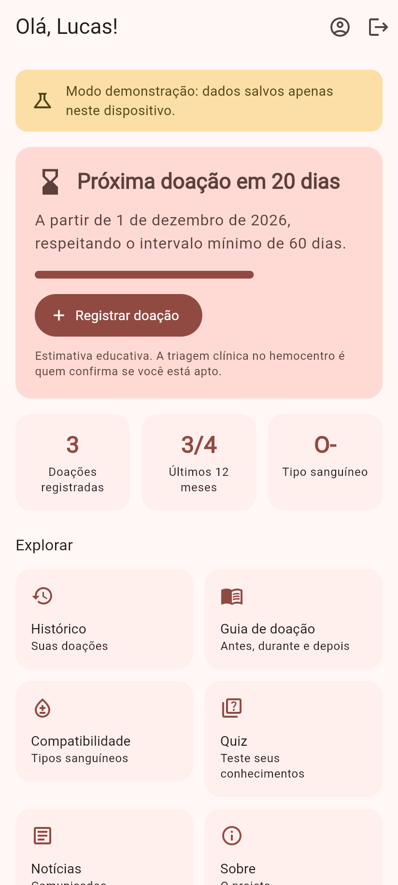
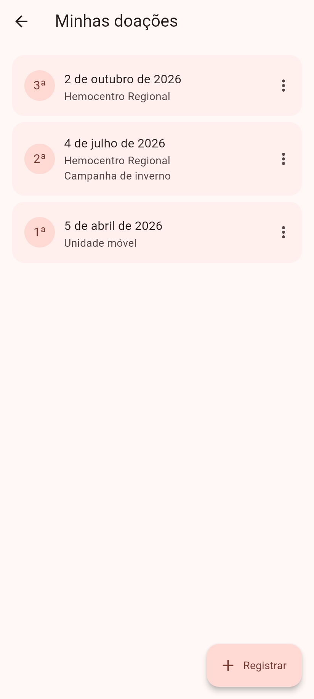
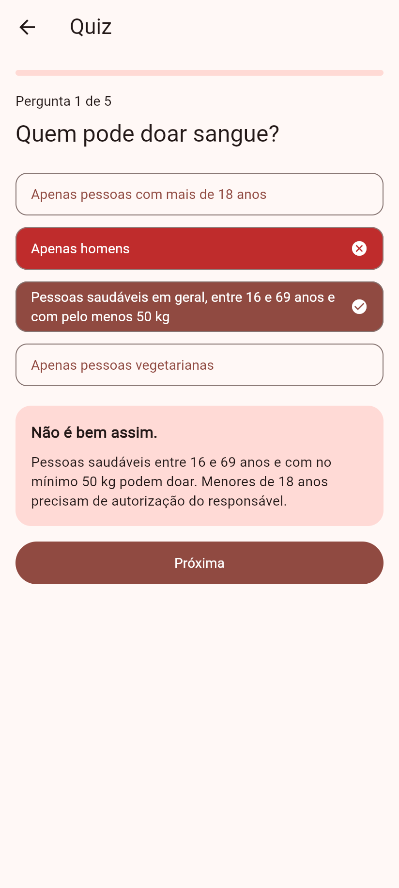
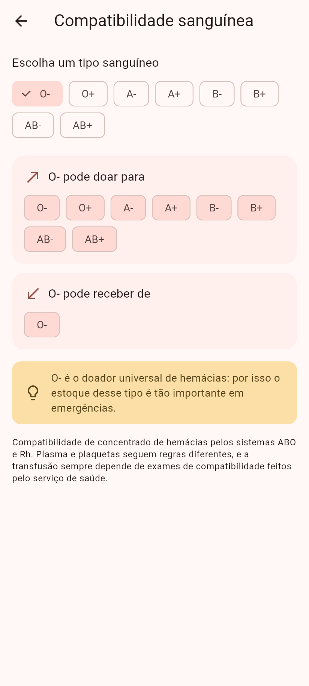
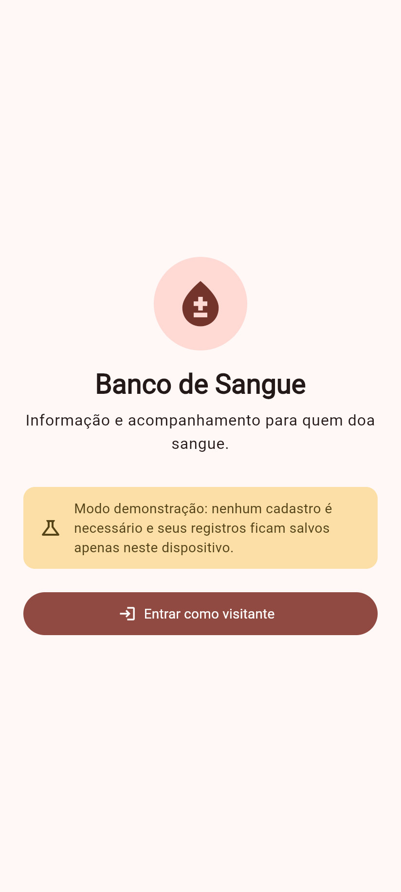
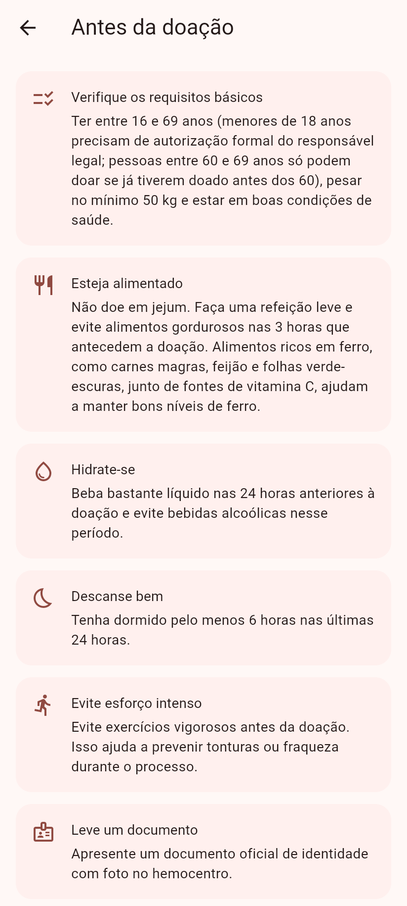
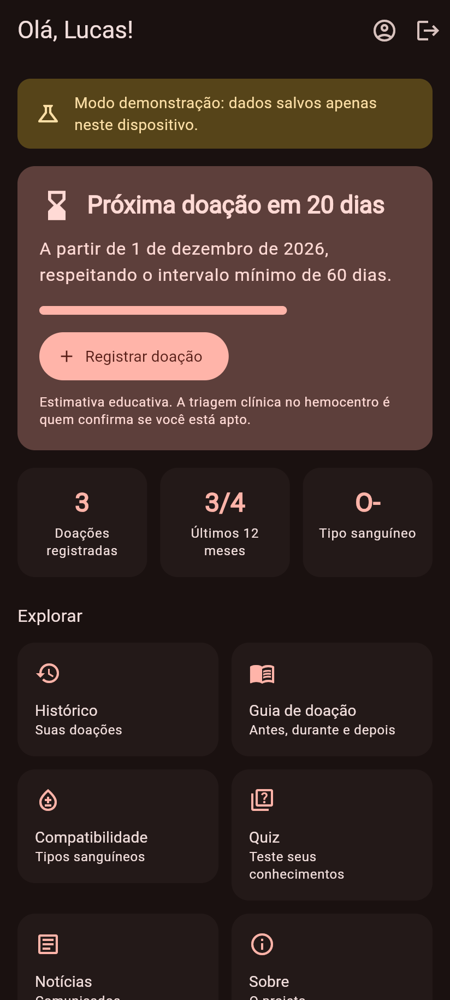
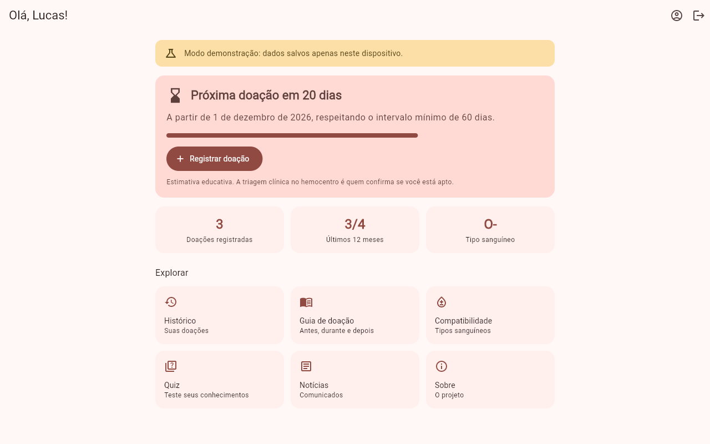

# Banco de Sangue

Monorepo com um app Flutter e uma API em TypeScript para quem doa sangue:
guia da doação, quiz educativo, histórico de doações e **estimativa da
próxima data em que a pessoa pode doar**, conforme as regras do Ministério
da Saúde.

Desenvolvido em 2023 como **Projeto de Iniciação Científica** no Centro de
Pesquisas em Informática da FEMA e modernizado em 2026. A evolução está
documentada em [docs/EVOLUCAO.md](docs/EVOLUCAO.md).

| Início | Histórico | Quiz com explicação | Compatibilidade |
| --- | --- | --- | --- |
|  |  |  |  |

<details>
<summary>Mais capturas (login, guia, registro, tema escuro, desktop)</summary>

| Login (demonstração) | Guia | Registrar doação | Tema escuro |
| --- | --- | --- | --- |
|  |  |  |  |



</details>

> As capturas são do build Web real no modo demonstração, com um doador
> fictício. Para regenerá-las, veja [Capturas de tela](#capturas-de-tela).

## Estrutura

```
apps/
├── mobile/   # App Flutter (Android, iOS e Web)
└── api/      # API REST em TypeScript (Fastify + SQLite)
docs/         # Evolução do projeto e capturas de tela
tool/         # Script que gera as capturas
```

## O problema

A doação de sangue é voluntária e depende de que doadores saibam se podem
doar e quando podem voltar. As regras de intervalo (60 dias para homens e 90
para mulheres) e de limite anual (4 e 3 doações) são pouco conhecidas, e
informações erradas afastam doadores. O projeto reúne, em um só lugar,
informação confiável e acompanhamento pessoal.

## Funcionalidades

| Funcionalidade | Origem |
| --- | --- |
| Guia antes, durante e depois da doação | 2023, revisado com fonte oficial em 2026 |
| Quiz educativo | 2023; explicações e progresso em 2026 |
| Registro e histórico de doações | 2023; edição, exclusão com "Desfazer" e validação de datas em 2026 |
| Notícias | 2023; publicação por administradores e estados de erro em 2026 |
| Login com e-mail e senha | 2023; cadastro e recuperação de senha em 2026 |
| **Próxima data apta para doar** (intervalo + limite em 12 meses) | 2026 |
| Perfil do doador (nome, sexo, tipo sanguíneo) | 2026 |
| Compatibilidade sanguínea ABO/Rh | 2026 |
| API própria em TypeScript (substitui o Firebase) | 2026 |
| Modo demonstração sem servidor | 2026 |
| Tema escuro, layout responsivo e acessibilidade | 2026 |

O cálculo de elegibilidade é uma **estimativa educativa**, e o app avisa
isso. A triagem clínica no hemocentro é quem decide.

### Dados reais, de demonstração e serviços externos

- **Modo demonstração (padrão do app):** nenhum servidor. Sessão, perfil e
  doações ficam no armazenamento local do dispositivo. As notícias são
  exemplos fictícios, marcados na tela.
- **Modo API:** contas, perfil, doações e notícias ficam na API
  ([apps/api](apps/api)). Nenhum serviço externo é usado.
- **E-mail:** não há provedor configurado. O código de redefinição de senha
  aparece no log da API.
- Os critérios de doação vêm do Ministério da Saúde: a página
  [Doação de Sangue](https://www.gov.br/saude/pt-br/assuntos/saude-de-a-a-z/d/doacao-de-sangue)
  e o [FAQ](https://www.gov.br/saude/pt-br/composicao/saes/sangue/faq).

## Como executar

Requisitos: Flutter **3.50** (Dart 3.14) e Node.js **22.12+**.

### Só o app (modo demonstração)

```sh
cd apps/mobile
flutter pub get
flutter run -d chrome     # entre como visitante
```

### App + API

```sh
# Terminal 1: API em http://127.0.0.1:3000 (documentação em /docs)
cd apps/api
npm ci
npm run dev

# Terminal 2: app
cd apps/mobile
flutter run -d chrome --dart-define=BACKEND=api
# Emulador Android: inicie a API com HOST=0.0.0.0 e use
#   --dart-define=API_URL=http://10.0.2.2:3000
```

O Android permite HTTP local no build de depuração. Para distribuir o app,
configure `API_URL` com a URL HTTPS da sua API; a permissão de internet já
está incluída no build de produção.

Crie uma conta pelo app. Para publicar notícias, promova a conta com
`npm run user:promote -- seu@email` em `apps/api`. O
[README da API](apps/api/README.md) descreve endpoints, segurança e Docker.

### Demonstração rápida

1. No modo demonstração, toque em **Entrar como visitante**.
2. Abra **Perfil** e informe nome e sexo.
3. Em **Histórico**, toque em **Carregar exemplos** ou registre uma doação.
4. Volte ao início: o cartão mostra quantos dias faltam para a próxima
   doação e quantas doações você fez nos últimos 12 meses.

## Arquitetura

```
┌───────────────── apps/mobile (Flutter) ──────────────────┐
│ features/   telas + view models (ChangeNotifier)         │
│ domain/     regras de elegibilidade e compatibilidade    │
│ data/       interfaces de repositório                    │
│   ├── local/  modo demonstração (shared_preferences)     │
│   └── api/    cliente HTTP + token no armazenamento      │
│               seguro (Keychain / Keystore)               │
└──────────────────────────┬───────────────────────────────┘
                           │ HTTPS + Bearer token
┌──────────────────────────▼─ apps/api (TypeScript) ───────┐
│ Fastify · Zod (validação + OpenAPI) · rate limit · Helmet│
│ modules/  auth · donor (perfil, doações) · news          │
│ Drizzle ORM → SQLite (migrações versionadas)             │
└──────────────────────────────────────────────────────────┘
```

**App:** MVVM, conforme o
[guia de arquitetura do Flutter](https://docs.flutter.dev/app-architecture).
O domínio é Dart puro, testado isoladamente. Os repositórios são interfaces
com duas implementações (local e API), escolhidas em tempo de compilação.
As rotas usam `go_router` com um único guard de autenticação.

**API:** módulos por recurso. Os schemas Zod validam a entrada, filtram a
saída e geram a documentação OpenAPI. Toda consulta de dados pessoais é
filtrada pelo usuário autenticado.

## Decisões técnicas

| Decisão | Por quê | Custo |
| --- | --- | --- |
| API própria no lugar do Firebase | Controle das regras, sem dependência de um projeto na nuvem, testável localmente | Manter servidor, banco e e-mail |
| Fastify + Zod | Rápido, tipado de ponta a ponta, OpenAPI gerado dos mesmos schemas | Menos convenções prontas que NestJS (desnecessárias neste tamanho) |
| SQLite + Drizzle | Sem infraestrutura extra; migrações em SQL versionadas | Uma instância só; para escalar, trocar por PostgreSQL |
| Tokens opacos com hash (não JWT) | Revogação imediata (logout, troca de senha) e token vazado do banco inútil | Uma consulta ao banco por requisição |
| `scrypt` nativo do Node | Recomendado pela OWASP, sem dependência nativa | Lento por design: ≈ 0,7 s por login na máquina de desenvolvimento, ocupando uma thread do libuv; o rate limit protege as rotas de autenticação |
| TypeScript 6.0 (não 7.0) | O `typescript-eslint` ainda não suporta o TS 7 | Adiar o compilador nativo |
| Datas `AAAA-MM-DD` | As regras de doação contam dias, não instantes; evita erros de fuso | Tolerância de 1 dia no servidor para fusos à frente |
| Modo demonstração no app | Avaliar sem rodar servidor | Duas implementações de repositório |
| `provider` + `ChangeNotifier`, `go_router` | Recomendados pela documentação do Flutter e suficientes aqui | Menos recursos que Riverpod/Bloc |
| `material_ui` | Substituto oficial de `package:flutter/material.dart`, deprecado desde o Flutter 3.47 | Pacote recente |

## Verificações

```sh
# API
cd apps/api && npm run lint && npm run typecheck && npm test && npm run build

# App
cd apps/mobile
dart format --set-exit-if-changed lib test
flutter analyze && flutter test
flutter build web && flutter build apk --debug
```

A CI ([.github/workflows/ci.yml](.github/workflows/ci.yml)) executa:

- **API:** lint, typecheck, testes, build e auditoria, em Node 22 e 24;
  também constrói a imagem Docker e faz um teste rápido nela.
- **App:** formatação, análise, testes, build Web e APK.

### Testes

- **API (29):** hash de senha e tokens; cadastro, login, logout e expiração
  de sessão; mesma resposta para e-mail inexistente e senha errada;
  redefinição de senha (uso único, expiração, invalidação e encerramento
  das sessões e confirmações simultâneas); rate limit; validação; **isolamento entre usuários**;
  permissões de administrador; headers, CORS e limite de corpo.
- **App (61):**
  - domínio: elegibilidade, anos bissextos, tabela ABO/Rh completa;
  - repositórios locais e da API (com `MockClient`): token, restauração
    de sessão, 401, falta de rede, formato de datas;
  - view models e fluxos completos de widget.

## Capturas de tela

```sh
cd apps/mobile && flutter build web
cd ../../tool/screenshots && npm install
node serve.mjs ../../apps/mobile/build/web 8766 &
node shoot.mjs http://127.0.0.1:8766 ../../docs/screenshots
```

O script usa o Chrome instalado (variável `CHROME_PATH`), cria uma sessão
fictícia no armazenamento local e captura cada tela.

## Limitações e próximos passos

- **E-mail:** a redefinição de senha precisa de um provedor de e-mail para
  uso real. Hoje o código só aparece no log da API.
- **Dados de 2023:** os registros antigos ficaram no Firestore do projeto
  original e não foram migrados. Uma migração exigiria acesso a esse
  projeto.
- **Plataformas:** o build iOS não foi feito, porque exige macOS.
- **Próximos passos:** lembrete local quando a data de doação chegar,
  PostgreSQL para produção, mapa de hemocentros a partir de dados oficiais
  e publicação do build Web.

## Autores

- Matheus Saleh
- Gabriel Eduardo

Centro de Pesquisas em Informática da FEMA.
