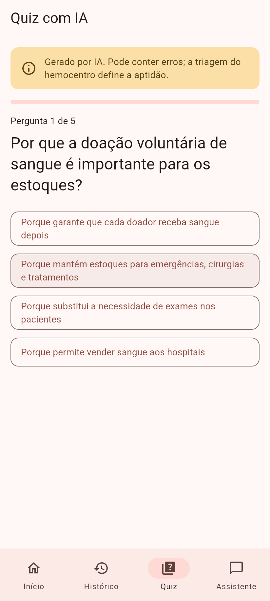
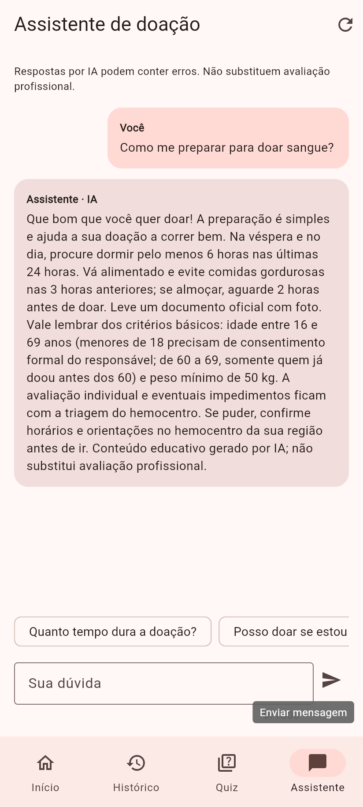
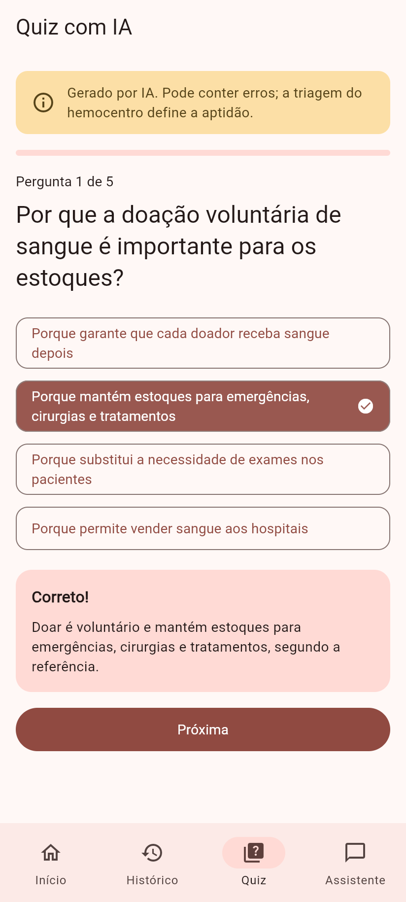
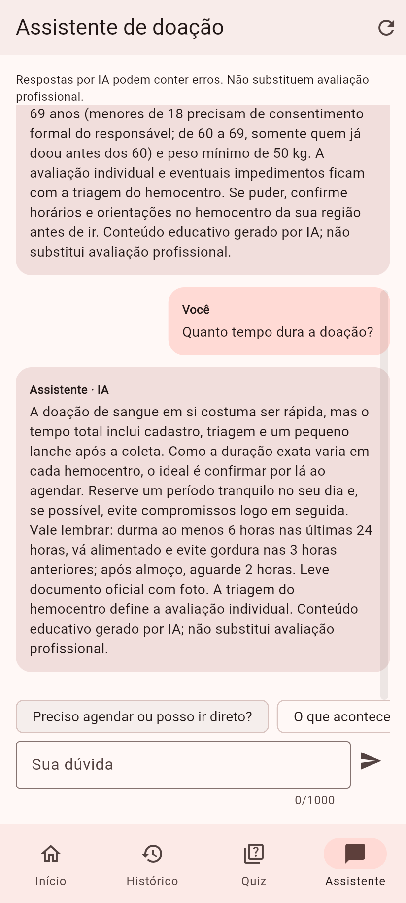
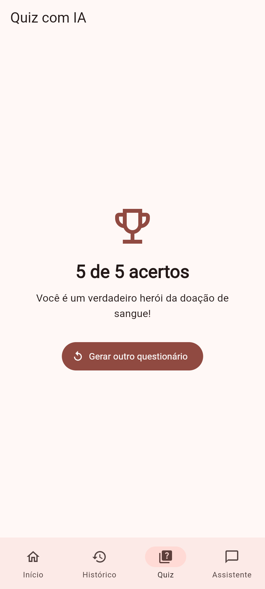
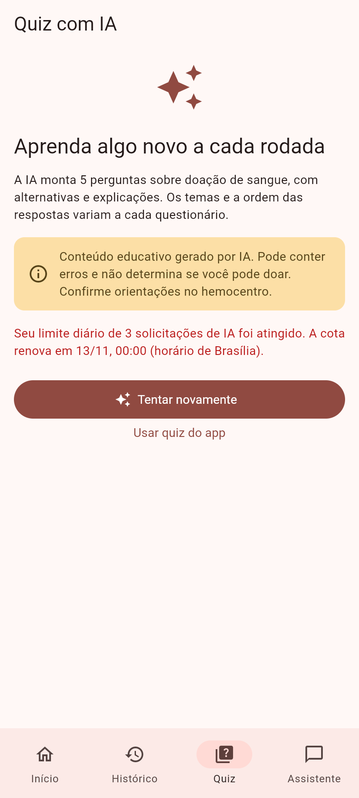

# Banco de Sangue

Monorepo com um app Flutter e uma API em TypeScript para quem doa sangue:
guia educativo, histórico de doações, estimativa da próxima data para doar
e **questionários e assistente de dúvidas com Venice AI**. A navegação
inferior mantém o quiz e a conversa ao trocar de aba, e o backend controla
uma cota diária de IA por conta.

Desenvolvido em 2023 como **Projeto de Iniciação Científica** no Centro de
Pesquisas em Informática da FEMA e modernizado em 2026. A evolução está
documentada em [docs/EVOLUCAO.md](docs/EVOLUCAO.md).

| Início e navegação inferior | Questionário gerado por IA | Assistente com perguntas sugeridas |
| --- | --- | --- |
|  |  |  |

<details>
<summary>Mais capturas: explicações, conversa contextual, cota diária e demais telas</summary>

| Explicação da resposta | Continuação da conversa |
| --- | --- |
|  |  |

| Resultado do questionário | Limite diário atingido |
| --- | --- |
|  |  |

| Histórico com dados fictícios | Compatibilidade de hemácias |
| --- | --- |
|  |  |

| Login com conta | Guia de preparo |
| --- | --- |
|  |  |

| Registro de doação | Quiz local, disponível sem IA |
| --- | --- |
|  |  |


</details>

> Capturas do build Web real em modo API, com o doador fictício Lucas Andrade
> em um banco separado. O quiz e o chat exibem respostas reais do Venice.
> A cota do ambiente de captura foi reduzida a **3 solicitações** para mostrar
> o bloqueio; o padrão do app é **20 por dia**. Veja [Capturas de tela](#capturas-de-tela).

## Estrutura

```
apps/
├── mobile/   # App Flutter (Android, iOS e Web)
└── api/      # API REST em TypeScript (Fastify + SQLite)
docs/         # Evolução do projeto e capturas de tela
tool/         # Script que gera as capturas
```

## O problema

A doação de sangue é voluntária e depende de que doadores saibam se podem
doar e quando podem voltar. As regras de intervalo (60 dias para homens e 90
para mulheres) e de limite anual (4 e 3 doações) são pouco conhecidas, e
informações erradas afastam doadores. O projeto reúne, em um só lugar,
informação confiável e acompanhamento pessoal.

## Funcionalidades

| Funcionalidade | Origem |
| --- | --- |
| Guia antes, durante e depois da doação | 2023, revisado com fonte oficial em 2026 |
| Quiz educativo | 2023; explicações e progresso em 2026 |
| Questionários aleatórios com IA: 5 perguntas, alternativas embaralhadas e explicações | 2026; Venice AI pelo backend |
| Assistente sobre doação e bancos de sangue, com contexto e perguntas sugeridas | 2026 |
| Barra inferior: Início, Histórico, Quiz e Assistente, preservando o estado das abas | 2026 |
| Cota diária de IA por conta, compartilhada entre quiz e chat e persistida no SQLite | 2026; padrão de 20 solicitações, renovado à meia-noite de Brasília |
| Registro e histórico de doações | 2023; edição, exclusão com "Desfazer" e validação de datas em 2026 |
| Notícias | 2023; publicação por administradores e estados de erro em 2026 |
| Login com e-mail e senha | 2023; cadastro e recuperação de senha em 2026 |
| **Próxima data apta para doar** (intervalo + limite em 12 meses) | 2026 |
| Perfil do doador (nome, sexo, tipo sanguíneo) | 2026 |
| Compatibilidade sanguínea ABO/Rh | 2026 |
| API própria em TypeScript (substitui o Firebase) | 2026 |
| Modo demonstração sem servidor | 2026 |
| Tema escuro, layout responsivo e acessibilidade | 2026 |

O cálculo de elegibilidade é uma **estimativa educativa**, e o app avisa
isso. A triagem clínica no hemocentro é quem decide.

### Dados reais, de demonstração e serviços externos

- **Modo demonstração (padrão do app):** nenhum servidor. Sessão, perfil e
  doações ficam no armazenamento local do dispositivo. As notícias são
  exemplos fictícios, marcados na tela.
- **Modo API:** contas, perfil, doações e notícias ficam na API
  ([apps/api](apps/api)). O quiz com IA e o chat usam o Venice AI.
  Apenas o conteúdo do chat é enviado ao provedor: perfil e histórico de
  doações não são incluídos automaticamente. A conversa fica na memória durante
  a sessão; Nova conversa e sair da conta a descartam. Evite compartilhar informações pessoais.
- **E-mail:** não há provedor configurado. O código de redefinição de senha
  aparece no log da API.
- Os critérios de doação vêm do Ministério da Saúde: a página
  [Doação de Sangue](https://www.gov.br/saude/pt-br/assuntos/saude-de-a-a-z/d/doacao-de-sangue)
  e o [FAQ](https://www.gov.br/saude/pt-br/composicao/saes/sangue/faq).

## Como executar

Requisitos: Flutter **3.50** (Dart 3.14) e Node.js **22.12+**.

### Só o app (modo demonstração)

```sh
cd apps/mobile
flutter pub get
flutter run -d chrome     # entre como visitante
```

### App + API

```sh
# Terminal 1: API em http://127.0.0.1:3000 (documentação em /docs)
cd apps/api
npm ci
npm run dev

# Terminal 2: app
cd apps/mobile
flutter run -d chrome --dart-define=BACKEND=api
# Emulador Android: inicie a API com HOST=0.0.0.0 e use
#   --dart-define=API_URL=http://10.0.2.2:3000
```

O Android permite HTTP local no build de depuração. Para distribuir o app,
configure `API_URL` com a URL HTTPS da sua API; a permissão de internet já
está incluída no build de produção.

Crie uma conta pelo app. Para publicar notícias, promova a conta com
`npm run user:promote -- seu@email` em `apps/api`. O
[README da API](apps/api/README.md) descreve endpoints, segurança e Docker.

### Configurar a IA (Venice)

Adicione ao arquivo **`apps/api/.env`**, que não é versionado:

```dotenv
VENICE_API_KEY=sua_chave_do_venice
VENICE_MODEL=
AI_DAILY_LIMIT=20
```

Reinicie `npm run dev`. A chave fica somente no backend; não use
`--dart-define` para passá-la ao Flutter. `VENICE_MODEL` é opcional: vazio,
a API consulta `/models` e usa o modelo padrão com suporte a respostas
estruturadas (ou o primeiro compatível). Você pode fixar um ID disponível
com `supportsResponseSchema=true`.

No app em modo API, abra **Quiz → Gerar questionário com IA** ou
**Assistente**. São geradas 5 questões com alternativas e explicações,
com temas e alternativas embaralhados. No chat, digite sua dúvida ou toque
nas perguntas sugeridas; as sugestões mudam conforme a conversa.
**Nova conversa** limpa o contexto. A barra inferior dá acesso a Início,
Histórico, Quiz e Assistente, preservando o progresso e o chat ao trocar abas.
Sem chave, o app informa a indisponibilidade
e permite usar o quiz original. O modo demonstração mantém o quiz local.

Os conteúdos de IA são educativos, podem conter erros e não substituem a
triagem do hemocentro. A referência de preparo usada nos prompts é o
[Ministério da Saúde](https://www.gov.br/saude/pt-br/composicao/saes/doacao-de-sangue),
conferida em 12/11/2026. Não há pesquisa na web em tempo real.
As chamadas consomem créditos da sua conta Venice.

A API limita a IA a **20 solicitações por conta por dia**, compartilhadas
entre chat e quiz. Cada questionário gerado ou mensagem enviada (inclusive
uma sugestão tocada) usa uma solicitação. A cota renova à meia-noite de
`America/Sao_Paulo` e fica no SQLite: trocar de sessão, reinstalar o app ou
reiniciar a API não a zera. Altere `AI_DAILY_LIMIT` no `.env` e reinicie a API
para ajustar o valor; `0` bloqueia novas gerações.

Pedidos inválidos ou bloqueados antes da geração não gastam a cota.
Tentativas admitidas contam mesmo em falhas ou timeouts, pois o provedor
pode cobrar sem devolver uma resposta válida. Ao atingir o limite, o app
mostra quando a cota renova. Isso limita cada conta; múltiplos cadastros são
contas diferentes e exigem uma política adicional de cadastro/verificação
caso seja necessário controlar a mesma pessoa entre contas.

### Demonstração rápida

1. No modo demonstração, toque em **Entrar como visitante**.
2. Abra **Perfil** e informe nome e sexo.
3. Em **Histórico**, toque em **Carregar exemplos** ou registre uma doação.
4. Volte ao início: o cartão mostra quantos dias faltam para a próxima
   doação e quantas doações você fez nos últimos 12 meses.

## Arquitetura

```
┌───────────────── apps/mobile (Flutter) ──────────────────┐
│ features/   telas + view models (ChangeNotifier)         │
│ domain/     regras de elegibilidade e compatibilidade    │
│ data/       interfaces de repositório                    │
│   ├── local/  modo demonstração (shared_preferences)     │
│   └── api/    cliente HTTP + token no armazenamento      │
│               seguro (Keychain / Keystore)               │
└──────────────────────────┬───────────────────────────────┘
                           │ HTTPS + Bearer token
┌──────────────────────────▼─ apps/api (TypeScript) ───────┐
│ Fastify · Zod (validação + OpenAPI) · rate limit · Helmet│
│ modules/  auth · donor (perfil, doações) · news · ai     │
│ cota diária persistida → Venice AI via HTTPS            │
│ Drizzle ORM → SQLite (migrações versionadas)             │
└──────────────────────────────────────────────────────────┘
```

**App:** MVVM, conforme o
[guia de arquitetura do Flutter](https://docs.flutter.dev/app-architecture).
O domínio é Dart puro, testado isoladamente. Os repositórios são interfaces
com duas implementações (local e API), escolhidas em tempo de compilação.
As rotas usam `go_router` com um único guard de autenticação e
`StatefulShellRoute.indexedStack` para preservar o estado das quatro abas.
O formulário de doação abre fora da barra inferior para manter o foco no
registro. O chat libera espaço para o teclado ao digitar.

**API:** módulos por recurso. Os schemas Zod validam a entrada, filtram a
saída e geram a documentação OpenAPI. Toda consulta de dados pessoais é
filtrada pelo usuário autenticado.

## Decisões técnicas

| Decisão | Por quê | Custo |
| --- | --- | --- |
| API própria no lugar do Firebase | Controle das regras, sem dependência de um projeto na nuvem, testável localmente | Manter servidor, banco e e-mail |
| Fastify + Zod | Rápido, tipado de ponta a ponta, OpenAPI gerado dos mesmos schemas | Menos convenções prontas que NestJS (desnecessárias neste tamanho) |
| SQLite + Drizzle | Sem infraestrutura extra; migrações em SQL versionadas | Uma instância só; para escalar, trocar por PostgreSQL |
| Tokens opacos com hash (não JWT) | Revogação imediata (logout, troca de senha) e token vazado do banco inútil | Uma consulta ao banco por requisição |
| `scrypt` nativo do Node | Recomendado pela OWASP, sem dependência nativa | Lento por design: ≈ 0,7 s por login na máquina de desenvolvimento, ocupando uma thread do libuv; o rate limit protege as rotas de autenticação |
| TypeScript 6.0 (não 7.0) | O `typescript-eslint` ainda não suporta o TS 7 | Adiar o compilador nativo |
| Datas `AAAA-MM-DD` | As regras de doação contam dias, não instantes; evita erros de fuso | Tolerância de 1 dia no servidor para fusos à frente |
| Modo demonstração no app | Avaliar sem rodar servidor | Duas implementações de repositório |
| `provider` + `ChangeNotifier`, `go_router` | Recomendados pela documentação do Flutter e suficientes aqui | Menos recursos que Riverpod/Bloc |
| `material_ui` | Substituto oficial de `package:flutter/material.dart`, deprecado desde o Flutter 3.47 | Pacote recente |
| Venice somente no backend | A chave não entra no APK ou no build Web; validação e limites ficam no servidor | Exige conexão, saldo no provedor e tratamento de respostas incorretas |
| Cota diária com reserva atômica no SQLite | Evita ultrapassar o limite com sessões, dispositivos ou processos simultâneos | Todas as instâncias precisam usar o mesmo banco; tentativas admitidas contam mesmo se falharem |

## Verificações

```sh
# API
cd apps/api && npm run lint && npm run typecheck && npm test && npm run build

# App
cd apps/mobile
dart format --set-exit-if-changed lib test
flutter analyze && flutter test
flutter build web && flutter build apk --debug
```

A CI ([.github/workflows/ci.yml](.github/workflows/ci.yml)) executa:

- **API:** lint, typecheck, testes, build e auditoria, em Node 22 e 24;
  também constrói a imagem Docker e faz um teste rápido nela.
- **App:** formatação, análise, testes, build Web e APK.

### Testes

- **API (71 testes):** hash de senha e tokens; cadastro, login, logout e expiração
  de sessão; mesma resposta para e-mail inexistente e senha errada;
  redefinição de senha (uso único, expiração, invalidação e encerramento
  das sessões e confirmações simultâneas); rate limit; validação; **isolamento entre usuários**;
  permissões de administrador; headers, CORS e limite de corpo; integração
  Venice simulada, validação de saída, timeouts e cota diária (persistência,
  concorrência entre processos e renovação no fuso de Brasília).
- **App (74 testes):**
  - domínio: elegibilidade, anos bissextos, tabela ABO/Rh completa;
  - repositórios locais e da API (com `MockClient`): token, restauração
    de sessão, 401, falta de rede, formato de datas;
  - view models e fluxos completos de widget.
  - IA: tratamento das respostas e erros da API, contexto e sugestões do
    chat, geração e repetição de questionários, aviso de cota esgotada;
  - navegação: progresso e rascunhos preservados entre abas, teclado e
    limpeza do chat ao sair da conta.

## Capturas de tela

As capturas atuais são geradas por
[`tool/screenshots/shoot-api.mjs`](tool/screenshots/shoot-api.mjs). O script
cria uma conta fictícia, cadastra um perfil e três doações de exemplo e
controla o app real no Chrome. Ele faz **três chamadas ao Venice** (um quiz
e duas mensagens), consome créditos e demonstra o bloqueio da quarta chamada.
Não há chave, senha ou token nas imagens ou no manifesto
[`capture-info.json`](docs/screenshots/capture-info.json).

Em um **terminal exclusivo**, a partir da raiz, inicie uma API isolada com
a chave já configurada em `apps/api/.env`. Nunca aponte este script para
o banco de produção:

```powershell
cd apps/api
$env:PORT = '3001'
$env:DATABASE_PATH = './data/screenshots.db'
$env:AI_DAILY_LIMIT = '3'
npm run dev
```

Em outro terminal, compile o app para essa API:

```powershell
cd apps/mobile
flutter build web --release --dart-define=BACKEND=api --dart-define=API_URL=http://127.0.0.1:3001
```

Depois, em outro terminal, sirva o build:

```powershell
cd tool/screenshots
npm ci --ignore-scripts
node serve.mjs ../../apps/mobile/build/web 8766
```

Com os servidores rodando, execute em `tool/screenshots`:

```powershell
node shoot-api.mjs http://127.0.0.1:8766 ../../docs/screenshots http://127.0.0.1:3001
```

O script usa o Chrome instalado (`CHROME_PATH` permite indicar outro caminho).
As perguntas e respostas variam a cada execução. Ao terminar, encerre os
servidores com `Ctrl+C` e feche o terminal exclusivo das capturas para não
reutilizar suas variáveis no servidor principal. O script anterior
`shoot.mjs` permanece disponível para capturar apenas o modo demonstração.

## Limitações e próximos passos

- **E-mail:** a redefinição de senha precisa de um provedor de e-mail para
  uso real. Hoje o código só aparece no log da API.
- **Dados de 2023:** os registros antigos ficaram no Firestore do projeto
  original e não foram migrados. Uma migração exigiria acesso a esse
  projeto.
- **Plataformas:** o build iOS não foi feito, porque exige macOS.
- **Próximos passos:** lembrete local quando a data de doação chegar,
  PostgreSQL para produção, mapa de hemocentros a partir de dados oficiais
  e publicação do build Web.

## Autores

- Matheus Saleh
- Gabriel Eduardo

Centro de Pesquisas em Informática da FEMA.
